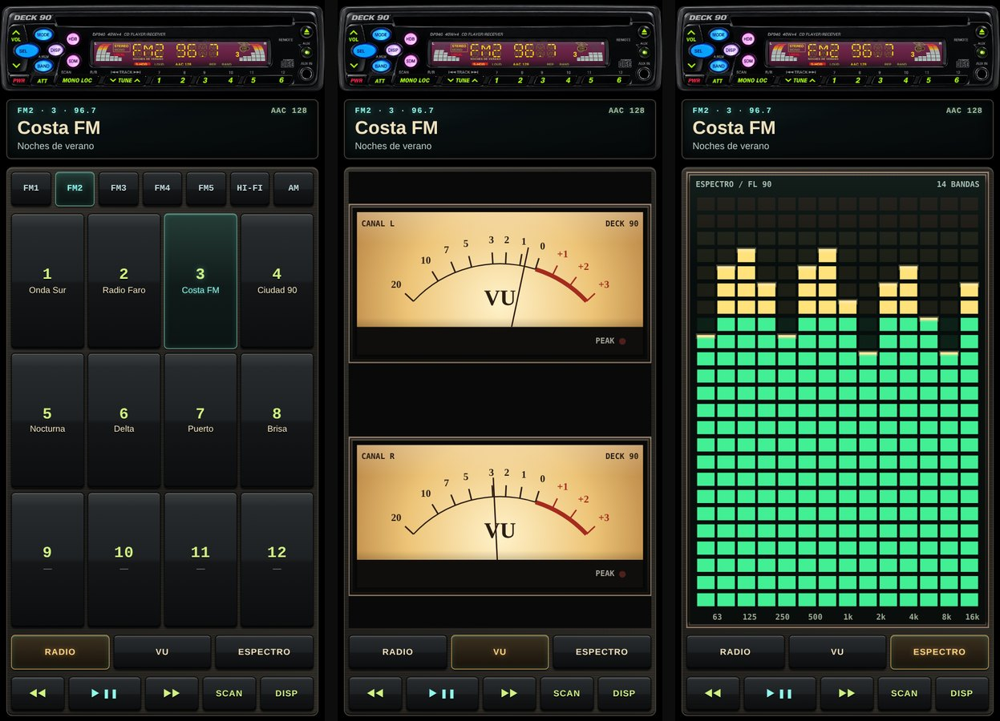
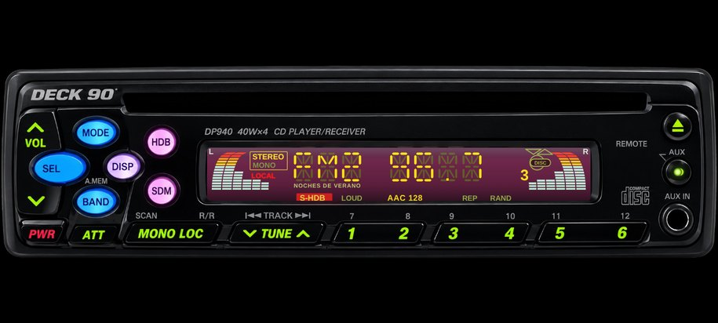
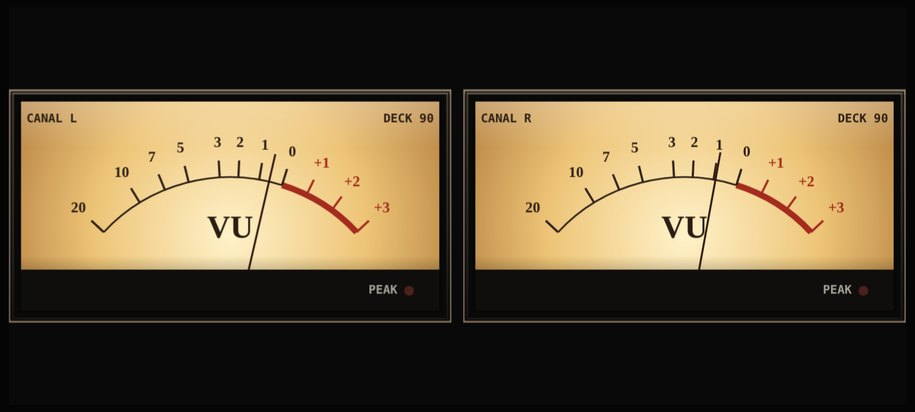
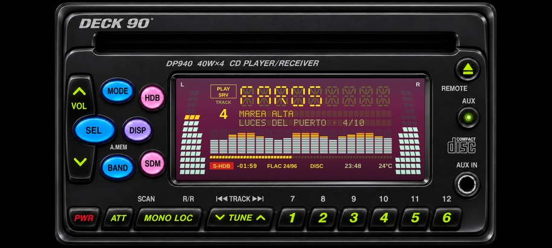
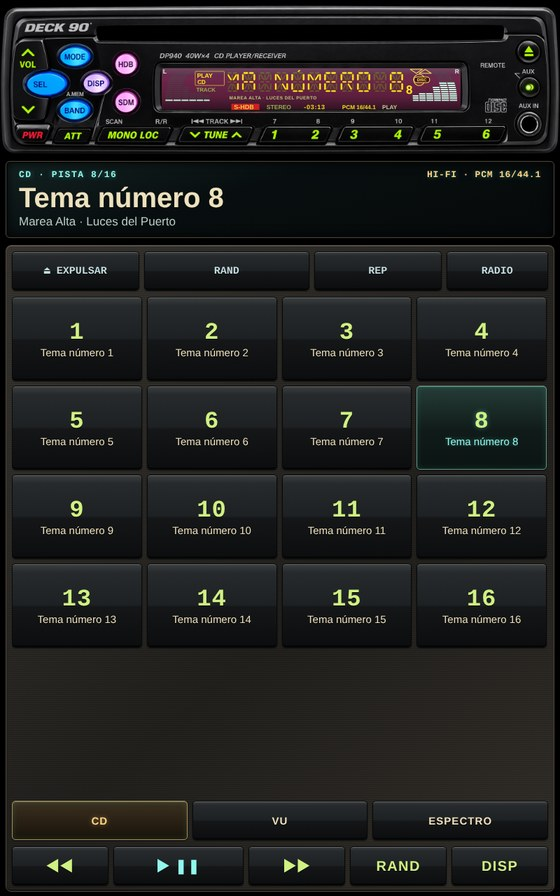
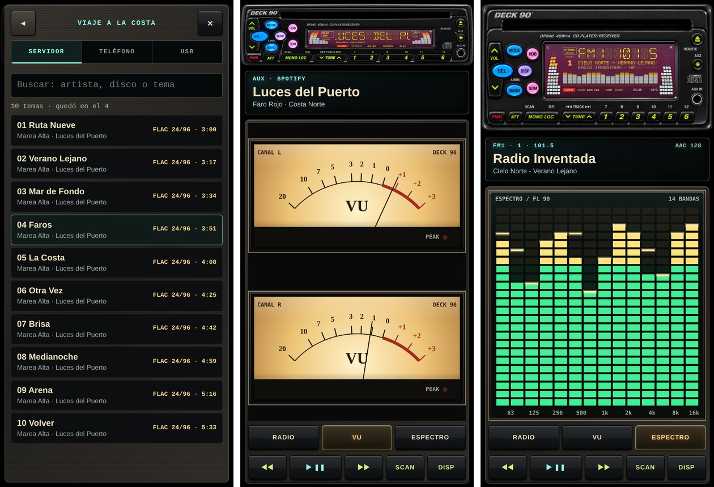
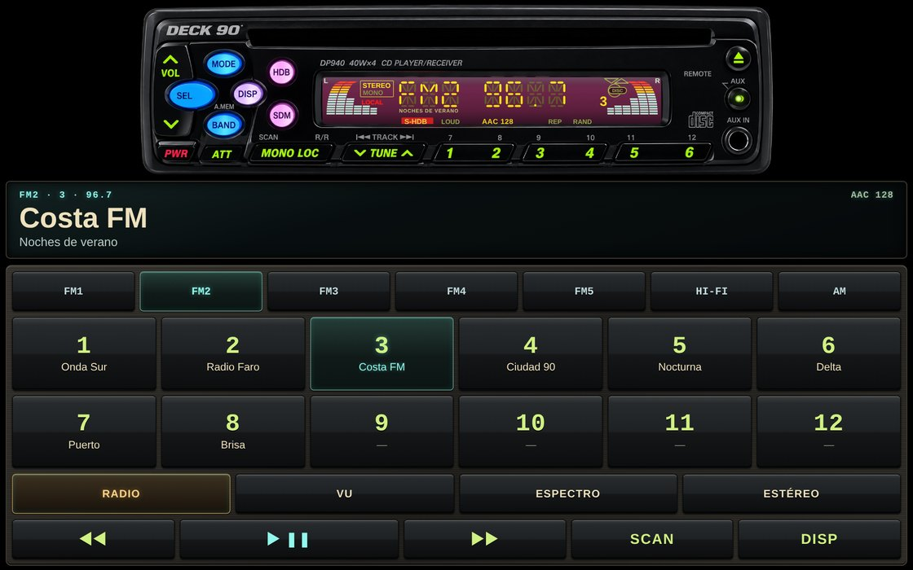

# Deck 90 for Android

[Español](README.md) · **English**

The '90s car stereo of [Deck 90](https://github.com/djkollmax/deck-90), on the phone, the tablet and in the car
(Android Auto). Free and open source.

- **The radio** with the same bands and memories as on the PC (FM1 to FM5, HI-FI and AM, twelve memories per band),
  **LOCAL** with the stations where you are, and a search of stations from all over the world.
- **Your music:** a pendrive (**USB**), **CDs** in a USB drive, the phone's own music and your **Jellyfin** server
  (**SERVER**), with the same lists as on the PC.
- **AUX:** what another app is playing, like Spotify or YouTube Music, on the display and under the stereo's keys.
- **The stereo's face**, DP940 or double DIN, with its display, its keys and its 36 looks, plus needle **VU meters**
  and a **spectrum** that measure what's playing.

To install it, see [Installing](#installing): it installs and updates with Obtainium.

The app itself speaks Rioplatense Spanish, like Deck 90 on the PC; this page explains it in English.

## On the phone

**Lying down**, the stereo's face fills the screen. Touching the display goes to the VU meters, then the spectrum and
back to the face.

**Standing**, the face is on top, with the station and the song in big letters below it. Further down you choose:

- **RADIO:** the bands and the twelve memories as big keys, with each station's name. A memory held keeps the station
  playing there.
- **VU:** two needle VU meters. Touching them changes their face: ÁMBAR, CREMA or HI-FI 90.
- **ESPECTRO:** a 14-band analyzer. Touching it changes its colour: FL 90, CIAN or ÁMBAR.

The VU meters and the spectrum measure the sound coming out of the speaker, at the moment it's heard.

### The stereo's keys

They're the same as on the PC:

- **SEL** pauses or plays again.
- **BAND** changes band. Held, it keeps the station playing: A.MEM, then a number.
- **1 to 6** are the memories; held, 7 to 12.
- **◀◀ ▶▶** go to the previous or next station in the band. **SCAN** tries each for 8 seconds.
- **SCAN held** opens the world station search, by name and country. The one you touch plays, and the numbers below
  keep it in the band.
- **LOC** (next to SCAN) goes to the **LOCAL** band: the twelve most listened-to stations where you are, updated when
  you travel. LOC again goes back to the band before. **Held**, it opens the search with all the stations around (also
  **CERCA** in the search). The first time it asks for your approximate location.
- **VOL ▲** goes up one step and **▼** three. **ATT** mutes. The volume shows big on the display.
- **DISP** changes what it shows: NORMAL, the time, the temperature (where you are; the first time it asks for your
  approximate location), time and temperature, and the weather.
- **SDM** goes through the PC's 36 display colours and looks, including those that change the whole face (TOKIO,
  ESTUDIO, TITANIO). Held, it goes back to the one before.
- **HDB** changes between four brightness levels. **HDB held** switches to the **double DIN stereo**, the PC's: twice
  as tall, with a big display (the station or the song in big letters, two dot-matrix lines with the song and the
  station or the artist and the album, a spectrum analyzer, the song's progress, the time and the temperature). Held
  again, the DP940.
- **PWR** switches off (GOOD BYE) and on (HELLO). Held, it sets the sleep timer (**SLEEP**): 15, 30, 60 or 90
  minutes, and again to clear it. At the end the radio fades out over 10 seconds and switches off, even with the screen
  off.
- **MODE** goes from the radio to **USB**, **CD** and **SERVER**, and back to the radio.
- **AUX** (the round key on the right) goes to another app's music: see [AUX](#aux-other-apps-music).

## USB and CD

- **USB:** the music on a pendrive plugged in with an OTG adapter, or in a folder of the phone or its card. **MODE held
  for a second** chooses it. Each folder with music is an album. ◀◀ ▶▶ change song, 1 to 6 (and 7 to 12 held) go to a
  song, **BAND** changes folder, **SCAN** is RAND and **LOC** is REP. The display shows each file's song, artist and
  album, and its quality (FLAC 24/96, MP3 320).
- **CD:** a USB CD or DVD drive (OTG). The first time, Android asks whether Deck 90 may use it. Audio CDs play exactly
  as they are on the disc, with the song names and the cover from MusicBrainz (if there's no internet when the disc goes
  in, it asks again by itself); discs with MP3 or FLAC files play too. Below, one key per song. **EJECT** opens the
  drive. If the drive doesn't spin up, it needs more power: use a Y cable or a powered hub.

## SERVER: your Jellyfin music

Like the DM-90 on the PC. The first time you choose SERVER with MODE, it asks for the server's address (for example
`192.168.0.199:8096`), your user and your password. Deck 90 keeps the permission Jellyfin gives it, never the
password. To sign in again, MÚSICA → SERVIDOR.

- **SOURCE:** in SERVER, **MODE held for a second** (or the tabs at the top of MÚSICA) goes through **SERVIDOR** (your
  Jellyfin), **TELÉFONO** (TEL: all the music in the phone's or tablet's memory and SD card, from the library Android
  already keeps, with artists, albums and covers; the first time Android asks for permission to read it) and **USB**.
  What you copy to the phone shows up by itself. In the car, TEL is **TEL · MÚSICA DEL TELÉFONO**.
- **MÚSICA** (above the numbers, or EJECT) opens the lists: **AL AZAR** (shuffle), **RECIENTES** (recent),
  **DISCOS** (albums), **ARTISTAS** (artists), **LO QUE SUENA** (now playing), **LISTAS** (playlists) and the search,
  which finds artists, albums and songs as you type.
- **LISTAS** are your Jellyfin playlists, the same ones you make in the PC's DM-90 (LISTS): each goes on from the song
  and the second where you left it, on the PC or on the phone.
- ◀◀ ▶▶ change song, 1 to 6 (and 7 to 12 held) go to a song, **BAND** changes album, **SCAN** is RAND and **LOC** is
  REP.
- It plays in the file's own quality; what the phone can't play, the server sends as FLAC. A song that can't be played
  is skipped.
- **Away from home**, with [Tailscale](https://tailscale.com) on in the phone and the PC: use the PC's Tailscale
  address as the server (`100.x.x.x:8096`), which works at home and away. If Tailscale is down while you're at home,
  Deck 90 tries the home address by itself (it learns it the first time it connects). In FLAC, an hour of music is
  about 400 MB of data.

## AUX: other apps' music

The **AUX** key, the round one on the right of the face, works like a real stereo's auxiliary input: it shows the
music another app on the phone is playing (Spotify, YouTube Music, a podcast) and controls it from the stereo.

- The display shows the song, the artist and the app.
- **SEL** pauses or plays it, **◀◀ ▶▶** change song and **PWR** pauses it.
- **MODE** goes back to the radio.

The first time, Android asks for two permissions:

- **Notification access**, to see the other app's player. Switch Deck 90 on in that list: it only looks at what's
  playing.
- **Microphone**, so the VU meters and the spectrum follow that music. Nothing is recorded: it measures what the phone
  is playing. It's coarser than with the radio, and after the volume. Without it, or if the phone doesn't give that
  sound, the VU meters and the spectrum stay still.

## On the tablet

The same as on the phone standing, in any position and with bigger letters and keys. Lying down, the memories go in
two rows of six and **ESTÉREO** is added: the face alone, as big as it fits. Touching the display goes back to the
radio.

## In the car (Android Auto)

The bands and their memories on the car's screen, **RADIOS LOCALES** (the stations around wherever the car is) and,
when they're there, **USB**, **CD** and **SERVER** with their songs. ◀◀ ▶▶ go to the previous or next station in the
band, and the song the station is playing shows. Android Auto runs from the phone: tablets don't have it.

## The stations

They come from [Radio Browser](https://www.radio-browser.info), as on the PC. For each station the best quality it
broadcasts is chosen: FLAC, then AAC or Opus, then MP3.

## Installing

With [Obtainium](https://github.com/ImranR98/Obtainium), which also keeps it up to date:

1. In Obtainium, tap **Add app** and paste `https://github.com/djkollmax/deck-90-android`.
2. Tap **Add** and then **Install**. If Play Protect warns you, choose to install anyway.

To just try it, you can also download the APK from the
[latest release](https://github.com/djkollmax/deck-90-android/releases/latest) and install it (it won't update by
itself then).

It needs Android 8 or newer. What's new in each version is in [CHANGELOG.md](CHANGELOG.md) and in each
[release](https://github.com/djkollmax/deck-90-android/releases).

### Android Auto

Android Auto only shows apps from the Play Store, unless you allow others once on the phone:

1. Settings → Android Auto (on Samsung, Settings → Connected devices → Android Auto) → scroll down to **Version** and
   tap it 10 times. Accept turning on developer settings.
2. Menu ⋮ at the top right → **Developer settings** → turn on **Unknown sources**.
3. Unplug the car and plug it in again: Deck 90 shows up among the music apps.

## Coming next

- Bringing the radio memories from the PC to the phone.
- Searching and choosing stations by voice in Android Auto.
- A better station search.
- Showing the radio on the TV from the tablet, with the tablet off.
- The song history and Last.fm.
- The DE-90 equalizer.
