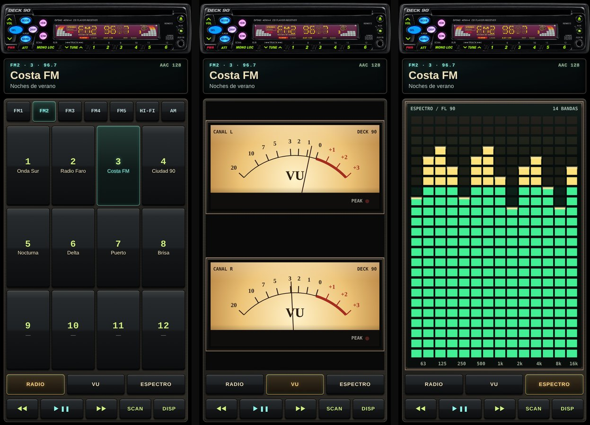
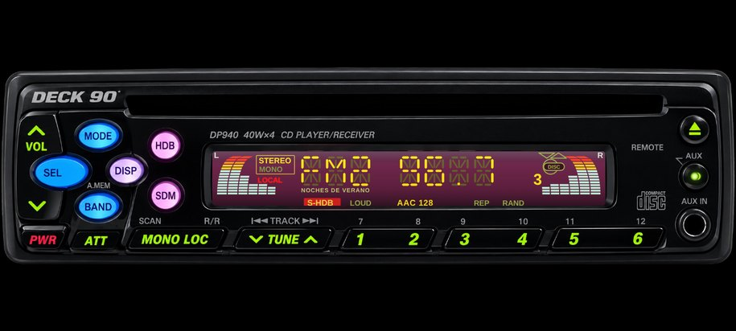
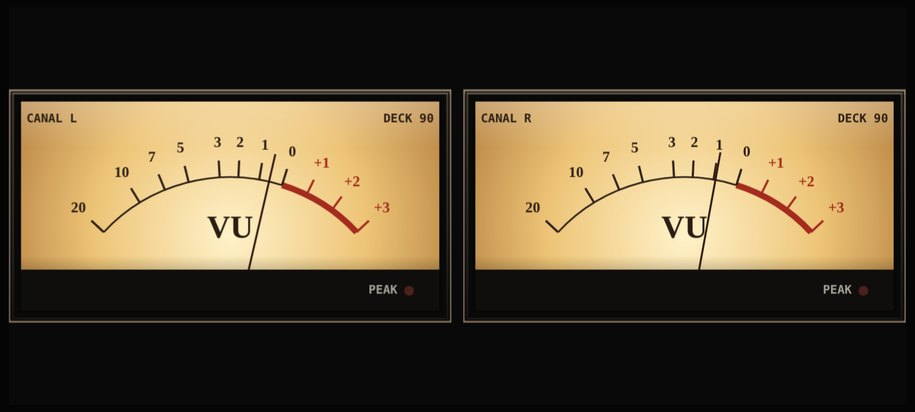
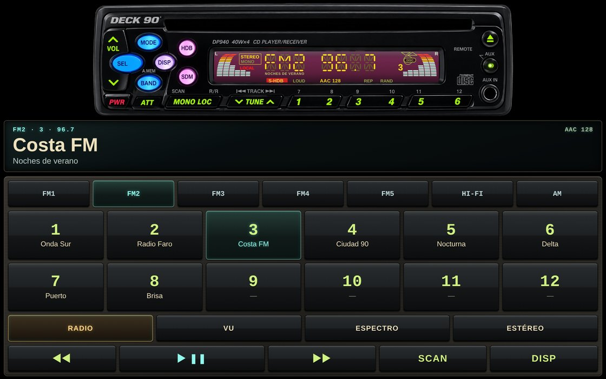

# Deck 90 para Android

El estéreo de [Deck 90](https://github.com/djkollmax/deck-90) en el celular, la tablet y el auto: la radio con las
mismas bandas y memorias que en la PC (FM1 a FM5, HI-FI y AM, doce memorias por banda) y LOCAL, las radios de donde
estés; la música de un pendrive (USB), los CD de una lectora por USB y tu música de Jellyfin (SERVER); y el frente
del estéreo del auto con su display, sus teclas y sus looks.

## En el celular

**Acostado**, el frente del estéreo ocupa toda la pantalla. Tocando el display pasás a los VU, después al espectro y
de vuelta al frente.

**Parado**, arriba queda el frente y debajo la radio y el tema en grande. Más abajo elegís:

- **RADIO:** las bandas y las doce memorias como teclas grandes, con el nombre de cada radio. Una memoria mantenida
  guarda ahí la que suena.
- **VU:** dos VU de aguja. Tocándolos cambian de cara: ÁMBAR, CREMA o HI-FI 90.
- **ESPECTRO:** un analizador de 14 bandas. Tocándolo cambia de color: FL 90, CIAN o ÁMBAR.

Los VU y el espectro miden el sonido que sale por el parlante, en el momento en que se escucha.

### Las teclas del estéreo

Son las mismas que en la PC:

- **SEL** pone pausa o vuelve a sonar.
- **BAND** pasa de banda. Mantenida, guarda la que suena: A.MEM y después un número.
- **1 a 6** son las memorias; mantenidos, de la 7 a la 12.
- **◀◀ ▶▶** pasan de radio dentro de la banda. **SCAN** prueba cada una 8 segundos.
- **SCAN mantenido** abre la búsqueda de radios del mundo, por nombre y país. La que tocás suena, y los números de
  abajo la guardan en la banda.
- **LOC** (al lado de SCAN) pasa a la banda **LOCAL**: las doce radios más escuchadas de donde estés, que se ponen al
  día si viajás. LOC otra vez vuelve a la banda de antes. **Mantenida**, abre la búsqueda con todas las de la zona
  (también **CERCA** en la búsqueda). La primera vez pide la ubicación aproximada.
- **VOL ▲** sube de a un paso y **▼** de a tres. **ATT** silencia. El volumen se ve grande en el display.
- **DISP** cambia lo que muestra: NORMAL, HORA, TEMPERATURA (la de donde estés; la primera vez pide la ubicación
  aproximada), HORA Y TEMPERATURA y TIEMPO.
- **SDM** recorre los 36 colores y looks del display de la PC, incluidos los que cambian el frente entero (TOKIO,
  ESTUDIO, TITANIO). Mantenido, vuelve al anterior.
- **HDB** cambia entre cuatro brillos.
- **PWR** apaga (GOOD BYE) y prende (HELLO). Mantenido, programa el apagado automático (**SLEEP**): 15, 30, 60 o 90
  minutos, y otra vez para sacarlo. Al final la radio baja sola en 10 segundos y se apaga, aunque la pantalla esté
  apagada.
- **MODE** pasa de la radio a **USB**, al **CD** y a **SERVER**, y de vuelta a la radio.

## USB y CD

- **USB:** la música de un pendrive enchufado con un adaptador OTG, o de una carpeta del celular o de la tarjeta.
  **MODE apretado un segundo** la elige. Cada carpeta con música es un disco. ◀◀ ▶▶ pasan de tema, 1 a 6 (y 7 a 12
  manteniendo) van a un tema, **BAND** pasa de carpeta, **SCAN** es RAND y **LOC** es REP. El display muestra el tema,
  el artista y el disco de cada archivo, y la calidad (FLAC 24/96, MP3 320).
- **CD:** una lectora de CD o DVD por USB (OTG). La primera vez Android pregunta si Deck 90 puede usarla. Los CD de
  música suenan tal cual están en el disco, con los nombres y la tapa de MusicBrainz; los discos con MP3 o FLAC
  también. **EJECT** abre la lectora. Si la lectora no arranca, le falta corriente: usá un cable en Y o un hub con
  fuente.

## SERVER: tu música de Jellyfin

Como el DM-90 de la PC. La primera vez que elegís SERVER con MODE, pide la dirección del servidor (por ejemplo
`192.168.0.199:8096`), el usuario y la contraseña. Deck 90 guarda el permiso que le da Jellyfin, nunca la contraseña.
MODE apretado un segundo vuelve a pedirlos.

- **MÚSICA** (arriba de los números, o EJECT) abre las listas: **AL AZAR**, **RECIENTES**, **DISCOS**, **ARTISTAS**,
  **LO QUE SUENA** y la búsqueda, que encuentra artistas, discos y temas mientras escribís.
- ◀◀ ▶▶ pasan de tema, 1 a 6 (y 7 a 12 manteniendo) van a un tema, **BAND** pasa de disco, **SCAN** es RAND y **LOC**
  es REP.
- Suena en la calidad del archivo; lo que el celular no reproduce, el servidor lo manda como FLAC.
- **Fuera de casa**, con [Tailscale](https://tailscale.com) prendido en el celular y en la PC: poné como servidor la
  dirección de Tailscale de la PC (`100.x.x.x:8096`), que anda en casa y afuera. En FLAC, una hora de música son unos
  400 MB de datos.

## En la tablet

Lo mismo que en el celular parado, en cualquier posición y con letras y teclas más grandes. Acostada, las memorias van
en dos filas de seis y se suma **ESTÉREO**: el frente solo, lo más grande que entra. Tocando el display volvés a la
radio.

## En el auto (Android Auto)

Las bandas y sus memorias en la pantalla del auto, **RADIOS LOCALES** (las de la zona por donde va el auto) y, si
están, **USB**, **CD** y **SERVER** con sus temas. ◀◀ ▶▶ pasan de radio dentro de la banda, y se ve el tema que pasa
la radio. Android Auto funciona desde el celular: las tablets no lo tienen.

## Las radios

Salen de [Radio Browser](https://www.radio-browser.info), como en la PC. De cada radio se elige la mejor calidad que
transmite: FLAC, después AAC u Opus, después MP3.

## Instalarla

Con [Obtainium](https://github.com/ImranR98/Obtainium), que además la mantiene actualizada:

1. En Obtainium, tocá **Agregar app** y pegá `https://github.com/djkollmax/deck-90-android`.
2. Tocá **Agregar** y después **Instalar**. Si Play Protect avisa, elegí instalar de todas formas.

Pide Android 8 o más nuevo. Las novedades de cada versión están en [NOVEDADES.md](NOVEDADES.md) y en cada
[versión publicada](https://github.com/djkollmax/deck-90-android/releases).

### Android Auto

Android Auto muestra solo las apps de Play Store, salvo que lo habilites una vez en el celular:

1. Ajustes → Android Auto (en Samsung, Ajustes → Dispositivos conectados → Android Auto) → bajá hasta **Versión** y
   tocala 10 veces. Aceptá activar los ajustes de desarrollador.
2. Menú ⋮ arriba a la derecha → **Ajustes de desarrollador** → activá **Fuentes desconocidas**.
3. Desconectá y volvé a conectar el auto: Deck 90 aparece entre las apps de música.

## Lo que viene

- Pasar las memorias de radio de la PC al celular.
- Buscar y elegir radios por voz en Android Auto.
- Una búsqueda de radios mejor.
- Ver la radio en la tele desde la tablet, con la tablet apagada.
- El historial de temas y Last.fm.
- El ecualizador DE-90.
